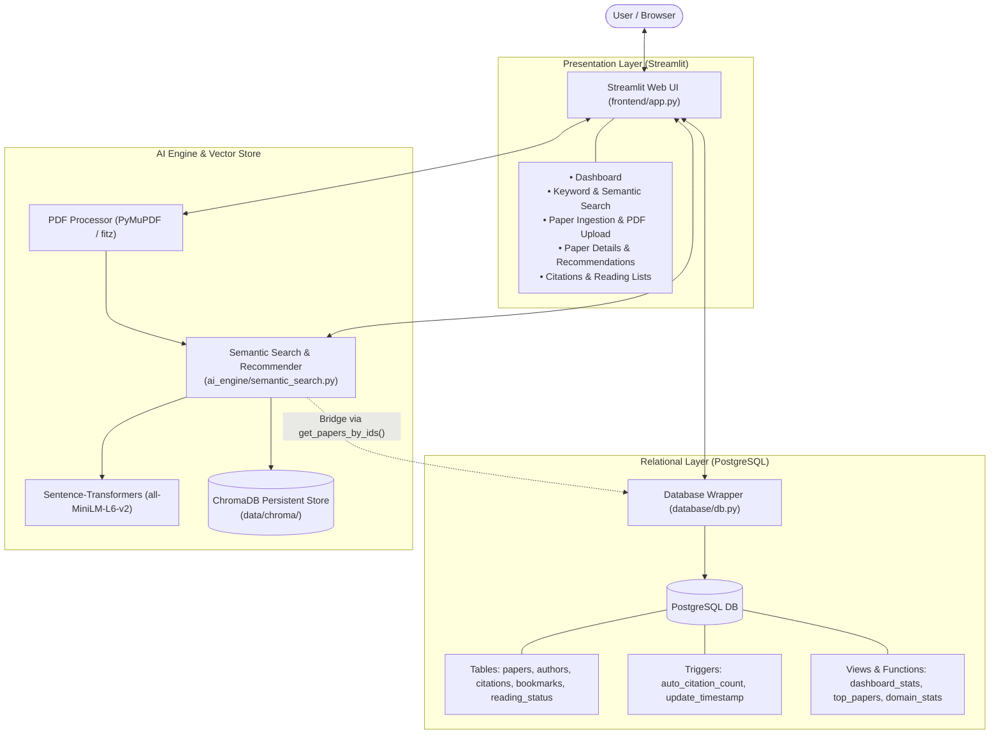
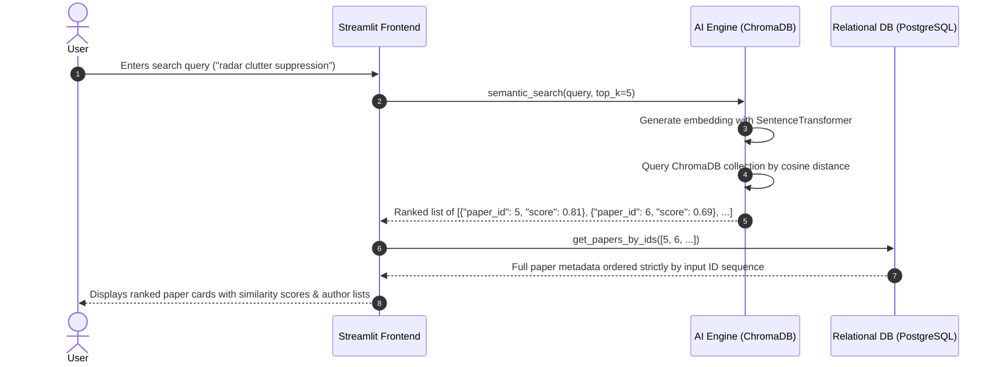

# ResearchHub System Architecture & Design Specification

ResearchHub is an AI-powered research paper management, discovery, and recommendation platform. It combines a relational database management system (**PostgreSQL**) with a vector embedding database (**ChromaDB**) and a Python frontend (**Streamlit**).

---

## 1. High-Level Architecture Overview

---

## 2. Component Design & Responsibilities

### 2.1 Presentation Layer (`frontend/app.py`)
Built with Streamlit, providing interactive multi-page navigation:
* **Dashboard:** High-level metrics (total papers, top authors, citations), domain distribution chart, and user activity.
* **Search Papers (Hybrid Discovery):**
  * *Keyword Search:* SQL filtering on title, author, domain, year, and abstract keywords with composite ordering.
  * *Semantic Search:* Natural language conceptual queries embedded into vectors and queried against ChromaDB.
* **Add Paper & Ingestion:** PDF upload with automatic text extraction (via PyMuPDF) or manual metadata entry. Automatically writes to PostgreSQL and indexes embeddings into ChromaDB.
* **Paper Details & Similar Papers:** Complete paper view, citation references, bookmarks/reading status controls, and "More Like This" recommendations.
* **Bookmarks & Reading List:** User-centric workflows (`want_to_read`, `reading`, `completed`).
* **Citations Explorer:** Multi-directional citation graph exploration (citing papers vs cited references).

### 2.2 Relational Storage Layer (`database/`)
PostgreSQL serves as the single source of truth for all structured metadata, relationships, and user states.

#### Entity Relationship Model
* `papers`: `paper_id` (PK), `title`, `abstract`, `publication_year`, `domain`, `pdf_path`, `citation_count`, timestamps.
* `authors`: `author_id` (PK), `name`, `affiliation`, timestamps.
* `paper_authors`: Composite PK (`paper_id`, `author_id`), `author_order`.
* `citations`: Composite PK (`citing_paper_id`, `cited_paper_id`), timestamp. Self-referential relationship.
* `users`: `user_id` (PK), `username`, `email`, `created_at`.
* `bookmarks`: Composite PK (`user_id`, `paper_id`), `created_at`.
* `reading_status`: Composite PK (`user_id`, `paper_id`), `status` (`want_to_read`, `reading`, `completed`), `updated_at`.

#### Integrity Constraints & Triggers
* **Publication Year Check:** Ensures years remain valid (`1900 <= publication_year <= 2100`).
* **Reading Status Check:** Restricts status to standard enum values.
* **Self-Citation Prevention:** Prevents `citing_paper_id = cited_paper_id`.
* **Citation Count Maintenance Trigger:**
  * Automatically increments `papers.citation_count` on `INSERT` in `citations`.
  * Automatically decrements `papers.citation_count` on `DELETE` in `citations`.
* **Timestamp Trigger:** Automatically updates `updated_at` timestamps on row modifications.

### 2.3 AI & Vector Engine Layer (`ai_engine/`)
Decoupled vector search and embedding pipeline:
* **Embedding Model (`embeddings.py`):** Uses `sentence-transformers/all-MiniLM-L6-v2` generating 384-dimensional dense vectors normalized for cosine similarity. Implements batch embedding (`embed_batch`) and single embedding (`embed_text`).
* **Vector Store (`chroma_store.py`):** Persistent ChromaDB client (`chromadb.PersistentClient`) stored in `data/chroma/`. Supports single upsert, batch upsert, vector distance search, vector extraction, and deletion.
* **Semantic Search & Recommendations (`semantic_search.py`):**
  * `semantic_search(query, top_k)`: Embeds natural-language queries, searches ChromaDB, and returns ranked `(paper_id, score)` tuples.
  * `get_similar_papers(paper_id, top_k)`: Extracts the target paper's stored embedding and retrieves nearest neighbors, filtering out self-matches.
  * `index_papers_batch(papers)`: Batch-indexes multiple papers in a single vectorized call.
* **PDF Extraction (`pdf_processor.py`):** Defensive text extractor built on PyMuPDF (`fitz`), supporting both local file paths and in-memory streams.

---

## 3. The PostgreSQL $\leftrightarrow$ ChromaDB Bridge Pattern

To ensure separation of concerns, the AI module never queries PostgreSQL directly, and PostgreSQL does not store raw vector embeddings.

The connection between both systems is governed by the shared primary key:
$$\text{paper\_id}_{\text{PostgreSQL}} \longleftrightarrow \text{str(paper\_id)}_{\text{ChromaDB}}$$

---

## 4. Verification and Testing

The system incorporates three levels of test coverage:
1. **Database Test Suite (`tests/test_database.py`):**
   * 69 unit and integration tests covering database connectivity, schema integrity, sample data validation, transactions, citation triggers, user activity views, and index verification.
2. **AI Engine Unit Tests (`tests/test_ai_engine.py`):**
   * 11 unit tests verifying embedding generation dimensions, batch embedding, ChromaDB persistent store operations, semantic ranking, similar paper recommendations, and PDF text extraction.
3. **End-to-End Integration Test (`tests/integration_test.py`):**
   * Validates full data flow: database retrieval $\rightarrow$ vector indexing $\rightarrow$ natural language semantic query $\rightarrow$ ranked metadata retrieval $\rightarrow$ similar paper recommendations.
